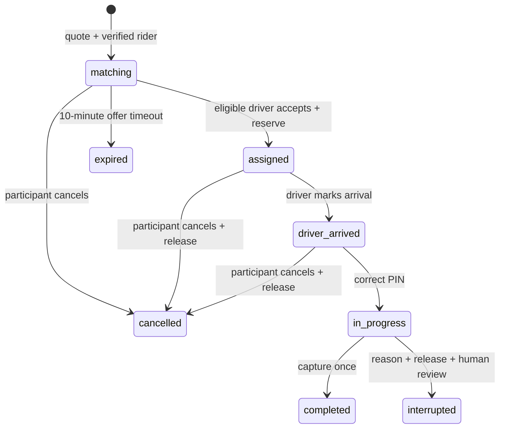

# Architecture and decisions

## Observed compatibility

PHP 8.3.31 / Composer 2.10.3 support Laravel 13.35.0 installed from the stable Laravel 13 release line. Laravel 13 requires PHP >=8.3: https://laravel.com/docs/13.x/releases. React documentation identifies React 19.2 as stable: https://react.dev/versions. Vite 8 requires Node 20.19+ / 22.12+: https://vite.dev/guide/. Node 24.19.0 satisfies it. Actual dependency resolutions are in the two lockfiles. Vite 8.3.4 was observed at build. PostgreSQL 18 supports partial unique indexes, row locks and JSONB used here. SQLite is deliberately unsupported for this schema and tests. PostGIS is not needed for fixture routing and is deferred.

## Boundaries

`backend/app/Domain/TripService.php`: pricing snapshots, booking, acceptance, transitions, credit ledger, expiry and presentation. `RoutingProvider` is replaceable; `DevelopmentRouting` supplies only declared fixtures. `RideController` adapts HTTP validation, session roles, OTP, driver applications, admin and support actions to persistence/services. `routes/ride.php` defines `/api/v1` beneath Laravel web middleware so CSRF and sessions apply. `PrivacyHeaders` prevents caching API responses and adds nosniff/frame/referrer protections. API exception rendering suppresses traces and normalizes errors.

`frontend/src` is a separate React SPA built to `backend/public/app`, served by Laravel. The public entry is same-origin; no browser bearer tokens or localStorage authentication. Dialog uses Radix accessibility primitives with local shadcn-style component ownership; Tailwind 4 and small custom CSS implement the design. No routing/geocoding SDK or large frontend state framework is required for this milestone.

This is a modular monolith foundation, not microservices. Extract controller responsibilities into Auth, Driver, Operations and Support controllers/services as they grow. Existing rules remain server-side. There is no Redis service installed; local session/cache use files and queue execution is synchronous. Production Redis and workers require operational validation. Business-critical state transitions are synchronous database transactions rather than relying on unimplemented events or queues.

## Authentication and authorization

`accounts` is the actual identity table; Laravel's untouched starter `users` table is unused. Session holds account_id. Phone verification creates a rider or recovers the existing account by unique phone; never changes existing role/name on login. OTP codes are random, hashed, expire after five minutes, consume once and allow five attempts. IP and phone rate limits apply. The development code is visible only with explicit adapters enabled outside production. Live SMS and secure recovery for lost/reassigned phone numbers are not implemented. A verified phone is not proof of full identity.

Roles: rider books; driver manages own console/application and assigned trip; reviewer reviews driver/vehicle/private documents; ops reads trips/ledgers/incidents and manages landmarks/resolutions; admin adds pricing/configuration/credit-adjustment privileges. Reviewers cannot inspect financial histories; ops cannot adjust balances or approve drivers. Staff creation and role assignment have no public endpoint. Seeded identities are fictional and local only. Mutating authenticated actions have per-account rate limits, with tighter OTP/booking/PIN limits.

Trip reads require rider ownership, assigned-driver ownership or admin/ops. Only participant accounts may transition a trip. PIN is returned only to owning rider on active trips, never in driver/admin API data. Documents use private local storage and authorized download; original filenames are not trusted. Uploads allow PDF/JPEG/PNG, max validator size 5 MB (PHP server upload limits may be lower). The first slice has one replaceable document slot, not a full verified identity/driving/vehicle document checklist.

Production blocks all demo login, OTP and fixture routing even if DEVELOPMENT_ADAPTERS=true. There is deliberately no production auth fallback. Production must use a separately configured database without demo seeds, HTTPS secure cookies, APP_DEBUG=false and real adapters. Runtime safeguards alone do not make this ready to deploy.

## State machine

Requested is atomically represented as matching with the first event; there is no separate persisted requested phase. `driver_arriving` is recognized for future clients, but the console goes assigned → driver_arrived. No endpoint can skip normal PIN start. Terminal states cannot return to active. After trip start cancellation is rejected; interruption requires a reason and creates a support review due in 48 hours. For this conservative first milestone, interruption releases the fee and records no revenue pending review. Exceptional resolutions are recorded with a reason; financial compensation requires a separate audited ledger entry.

Matching expiry is evaluated on trip/offer reads and `TripService::expire`; a production scheduler is not yet installed. Driver offers are broadcast by polling to eligible online drivers, excluding their declines. Reachable pickup ranking is unavailable; no straight-line estimate or ETA is claimed. Estimated trip duration/distance is the declared demo route fixture, not a pickup ETA.

## Transactions and integrity

Booking locks the rider account, compares idempotency request hash and checks active trips, then locks the quote and stores its immutable snapshot. `(rider_id, request_key)` and quote_id are unique. Acceptance locks driver then trip; an active-trip partial unique index protects both rider and driver constraints. Driver eligibility, current offer expiry and available credit are checked in that transaction. Completion locks trip and writes commission, cash settlement record, capture and terminal transition together. Reservations and commission/settlement records are unique per trip; references are unique in the credit ledger. Retried same-state actions return the existing result.

Cancellation locks trip then driver for release. Acceptance/cancellation can deadlock in some lock interleavings; transactions retry concurrency errors up to five times. Tests use separate PostgreSQL connections/processes to exercise these races. Database constraints remain the final integrity barrier. All database connections use UTC; operating hours and driver earning-day boundaries use Africa/Blantyre.

PostgreSQL triggers forbid UPDATE/DELETE of credit_ledger, commissions, trip_events, audit_records and pricing_rules. DB administrators still have privileged override capability. Reversals append new references. JSON snapshots are controlled by server code; no client writes financial values. Payment status and settlement remain separate from trip state. No GPS collection or automated fraud decision exists.

## Privacy and operations

Only chosen pickup/destination coordinates and notes are stored; rider browser geolocation is one-shot and user-triggered. No continuous rider tracking, background driver tracking, navigation or location collection after cancellation. Client booking references and temporary pickup note live in sessionStorage, not authentication tokens. Request logs should exclude bodies/phones/PINs/documents in production. Current database retains trip coordinates indefinitely: retention enforcement is a production blocker, not an implemented promise. Proposed launch policy is documented in PRODUCTION.md and must be approved before real data.